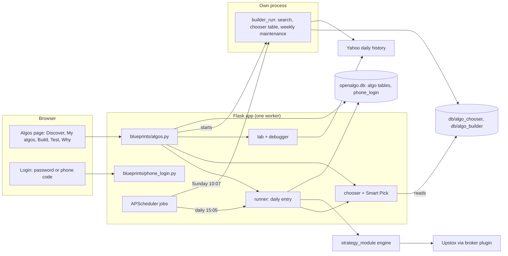
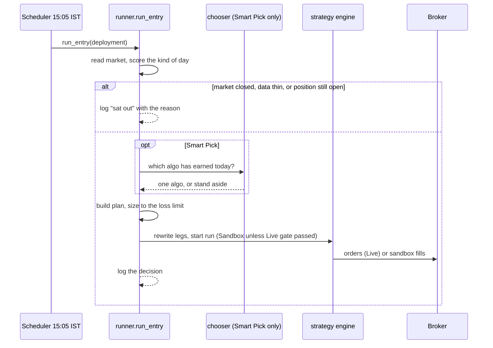
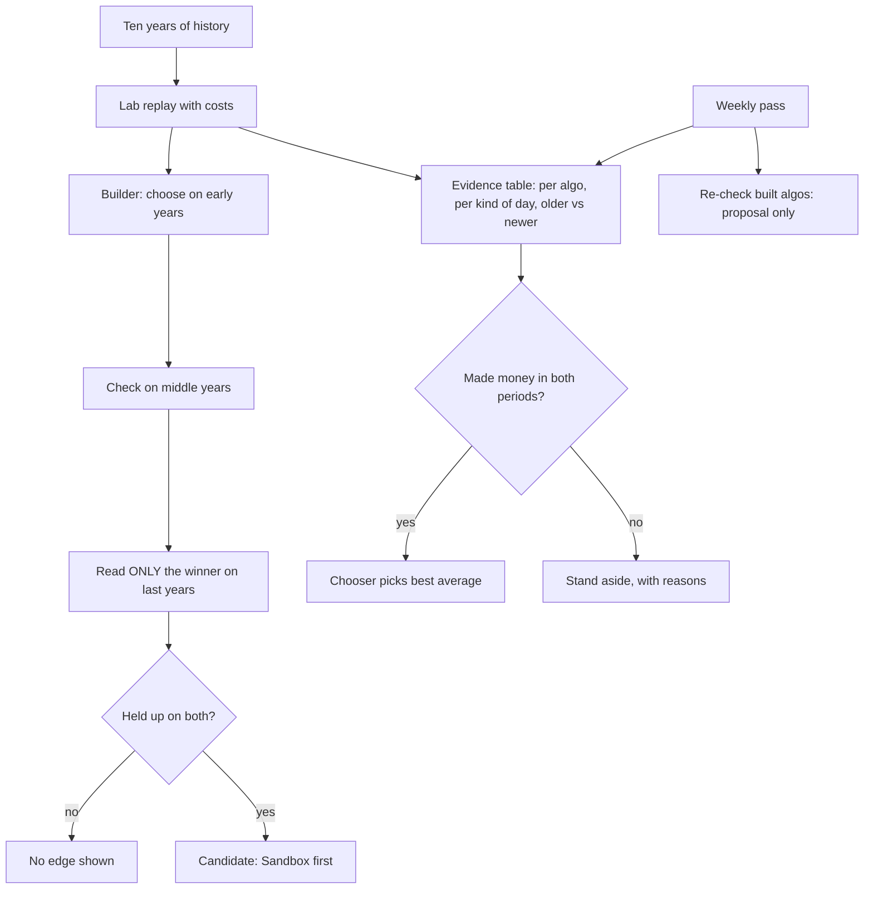

# Architecture of the Algos feature

The illustrated diagrams on docs.openalgo.in live in the separate `openalgo-docs` repository, which this
session could not reach. These are the same flows as Mermaid text, so they can be turned into those
images later. The other repository is untouched, and its diagrams are still the old ones.

## Components and who talks to whom

Ports and the market-data pipeline (5000, 8765, ZeroMQ 5555) are unchanged. The search runs in a separate
process on purpose: inside the single web worker it would stall every request and order for a minute.

## One day in the life of an algo

## How an algo gets chosen and refined

## What is stored where

| Thing | Where |
| --- | --- |
| Deployments, decisions, built algos | `openalgo.db` tables `algo_deployment`, `algo_decision`, `algo_custom` |
| Phone number for sign-in | `openalgo.db` table `phone_login` |
| Chooser evidence | `db/algo_chooser/table.json` |
| Search jobs and weekly proposals | `db/algo_builder/` (last 10 jobs kept, plus `proposals.json`) |
| Cached history | `db/algo_lab/` |
